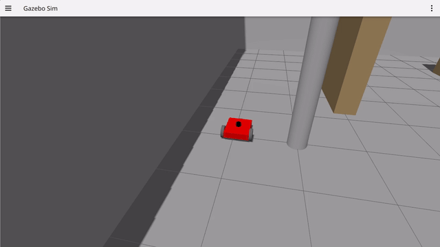
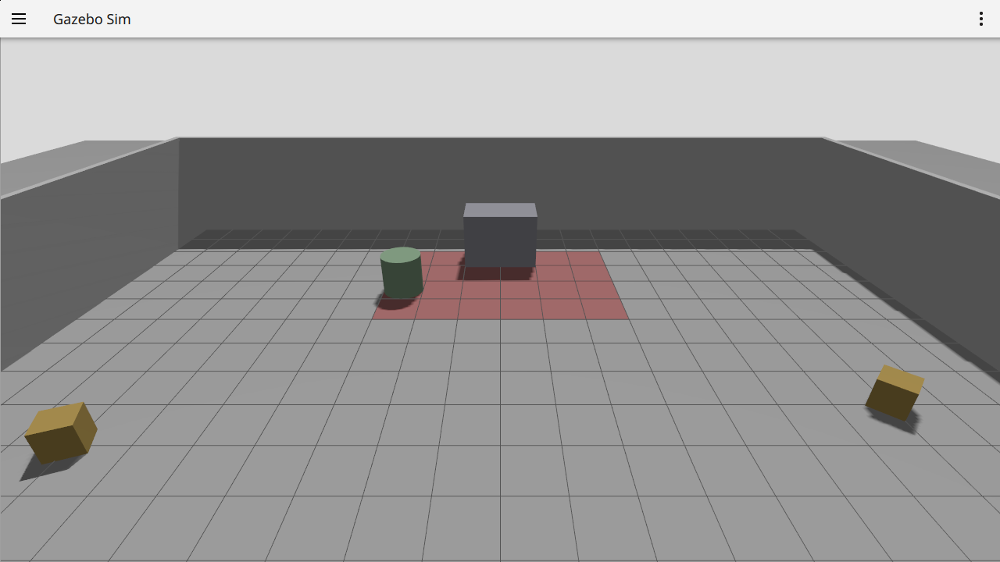
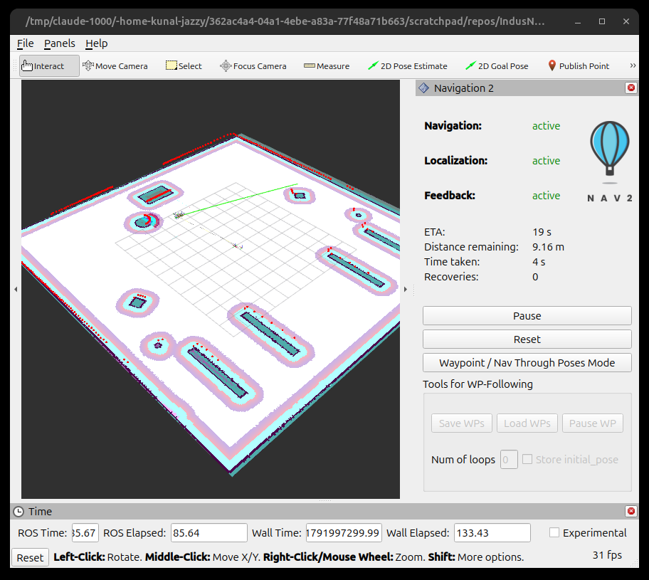
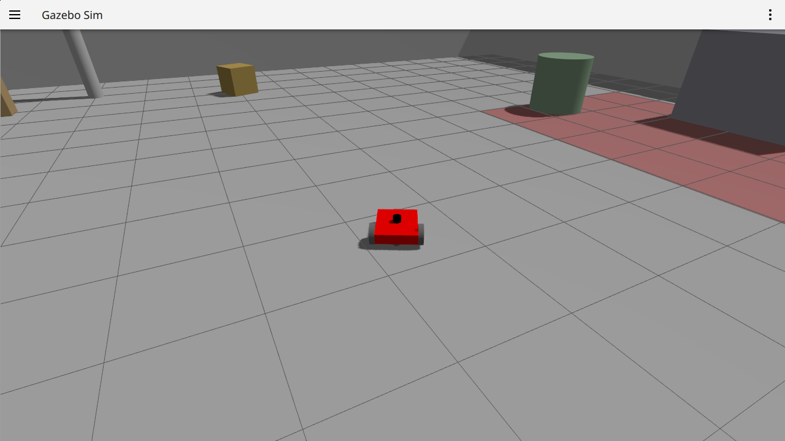
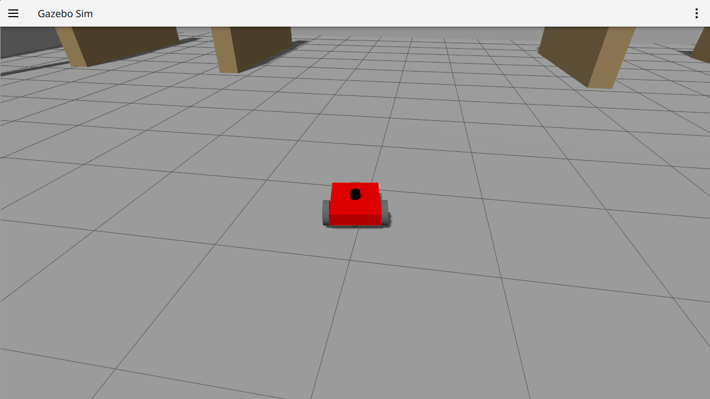
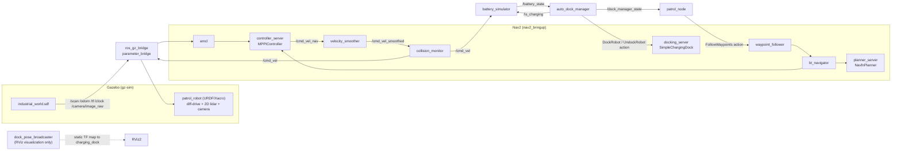

# IndusNav-AMR

Autonomous mobile robot stack for a simulated industrial warehouse, built on ROS 2 Jazzy and Nav2. A differential-drive robot patrols a fixed waypoint loop, tracks its own simulated battery based on how hard it's actually driving, and hands control to an `opennav_docking` action server to recharge before it runs out — then resumes the patrol on its own.


## Overview

Most Nav2 demo projects stop at "send one goal, watch the robot drive there." IndusNav-AMR instead runs a closed loop that a real warehouse AMR needs: patrol continuously, know when the battery is low, interrupt whatever it's doing to dock and charge, and pick the patrol back up afterward — without a human in the loop.

The stack is a `patrol_node` driving a four-waypoint loop through `nav2_waypoint_follower`, a `battery_simulator` that drains based on the robot's actual commanded speed (idle electronics draw plus a motion-proportional term, not a flat timer), and an `auto_dock_manager` state machine that watches the battery, cancels the active patrol goal, and drives the `DockRobot`/`UndockRobot` actions on Nav2's docking server. Everything runs in Gazebo against a custom industrial world with a marked "danger zone" that one of the patrol waypoints deliberately sits inside, to exercise the waypoint-skipped logging path.

This is a simulation-only reference stack — there is no physical robot or sensor hardware involved.

## Demo

22-second capture of the patrol loop running in Gazebo (chase camera), recorded on this machine with `ffmpeg` + `gz service`:



[Full-resolution MP4](docs/media/patrol-demo.mp4)

| Gazebo — warehouse world | RViz — Nav2 costmap + MPPI path |
|---|---|
|  |  |

| Auto-dock triggered at low battery | Docked and charging |
|---|---|
|  |  |

Terminal output from the run above, showing the actual battery-low → dock → charge handoff between nodes:

```
[auto_dock_manager]: Battery Low (19.99%). Starting Docking sequence.
[patrol_node]: Low battery detected! Cancelling patrol to allow docking.
[auto_dock_manager]: Docking successful! Transitioning to CHARGING.
```

## Key Features

- **Continuous waypoint patrol** — `patrol_node` sends a 4-pose loop through `nav2_waypoint_follower`'s `FollowWaypoints` action and automatically re-sends the goal when a loop completes, looping indefinitely until interrupted.
- **Motion-driven battery model** — `battery_simulator` subscribes to `/cmd_vel` and drains at `idle_drain_rate + motion_drain_rate * |speed|`, so a robot sitting idle drains far slower than one actively patrolling; a staleness timeout zeroes the motion term if commands stop arriving. Publishes `sensor_msgs/BatteryState` with current and drain scaled to match.
- **Battery-aware auto-docking** — `auto_dock_manager` is a small state machine (`IDLE → DOCKING → CHARGING → UNDOCKING → IDLE`) that cancels the active patrol goal via `nav2_simple_commander`, drives Nav2's `docking_server` (`opennav_docking::SimpleChargingDock`) through `DockRobot`/`UndockRobot` actions, and signals `patrol_node` to resume once undocked.
- **MPPI-based local control** — `controller_server` runs `nav2_mppi_controller::MPPIController` with cost, goal, path-alignment, path-angle, and prefer-forward critics tuned in `config/nav2_params.yaml`.
- **Configurable AMCL start pose** — `navigation.launch.py` and `docking.launch.py` expose `initial_pose_x` / `initial_pose_y` / `initial_pose_yaw` launch arguments (default `0.0, 0.0, 0.0`) so the robot doesn't have to start at the map origin.
- **Scripted hazard zone** — the world defines a visually marked 4 m × 6 m "danger zone," and one of the four patrol waypoints is deliberately placed inside it so `patrol_node` exercises its missed-waypoint / danger-zone logging path.
- **SLAM mapping** — `slam.launch.py` runs `slam_toolbox` in online-async mode against the same world to (re)generate the occupancy map used by AMCL.

## System Architecture



**Frames:** `map → odom → base_footprint → base_link → {lidar_link, camera_link → camera_optical_frame}`, plus a static `map → charging_dock` frame published for visualization.

**Velocity command pipeline:** `controller_server` (MPPI) publishes to `/cmd_vel_nav`, `velocity_smoother` smooths it onto `/cmd_vel_smoothed`, `collision_monitor` applies footprint-approach stopping and republishes the final `/cmd_vel`, which `ros_gz_bridge` forwards into Gazebo's `DiffDrive` plugin — and which `battery_simulator` also subscribes to directly, so its drain rate tracks the same velocity actually being commanded to the robot. Behavior-server recovery actions (spin, backup, drive-on-heading) are remapped onto the same `/cmd_vel_nav` stage so they also pass through the smoother and collision monitor.

**Camera:** the robot carries an RGB camera (`/camera/image_raw`, bridged from Gazebo) with an `Image` display configured in `rviz_config.rviz`, but nothing in this repo currently subscribes to or processes that feed — it's wired through for visualization and as a hook for future perception work.

**Note on the docking target:** `dock_pose_broadcaster` publishes a `/charging_dock_pose` topic and a static `map → charging_dock` TF, but nothing in the stack subscribes to either — they exist purely so RViz can show where the dock is. The pose Nav2's `docking_server` actually drives to comes from the static `home_dock` entry in `config/nav2_params.yaml` (`pose: [0.0, 0.0, 3.14159]`), referenced by `auto_dock_manager` via `dock_id: 'home_dock'`.

## Tech Stack

| Component | Technology |
|---|---|
| Middleware | ROS 2 Jazzy Jalisco |
| Simulator | Gazebo (`gz-sim`), bridged via `ros_gz_bridge` |
| Navigation | Nav2 (`nav2_bringup`), MPPI local controller, Navfn global planner |
| Docking | `opennav_docking` (`SimpleChargingDock` plugin) |
| Localization / Mapping | `nav2_amcl`, `slam_toolbox` (online async) |
| Robot description | URDF/Xacro, differential-drive + GPU lidar + RGB camera |
| Node logic | Python 3 (`rclpy`), `nav2_simple_commander`, ROS 2 actions |
| Build | `ament_cmake` / `ament_cmake_python`, `colcon` |

## Repository Structure

```text
IndusNav-AMR/
├── docs/
│   ├── media/                        # screenshots, demo GIF/MP4 (this README's assets)
│   └── results/                      # measured rate/CPU logs from a real run
└── src/navigation_pkg/
    ├── config/
    │   ├── nav2_params.yaml          # AMCL, MPPI controller, planner, docking_server, etc.
    │   └── mapper_params_online_async.yaml   # slam_toolbox params
    ├── launch/
    │   ├── rsp.launch.py             # robot_state_publisher only (included by the others)
    │   ├── simulation.launch.py      # Gazebo + spawn + ros_gz_bridge (included by the others)
    │   ├── slam.launch.py            # simulation + slam_toolbox + RViz (map building)
    │   ├── navigation.launch.py      # simulation + Nav2 + RViz (no battery/docking)
    │   └── docking.launch.py         # full stack: navigation + battery + auto-dock + patrol
    ├── maps/                         # industrial.yaml / industrial.pgm (output of slam.launch.py)
    ├── navigation_pkg/
    │   ├── patrol_node.py            # waypoint patrol loop + danger-zone logging
    │   ├── battery_simulator.py      # motion-driven BatteryState publisher
    │   ├── auto_dock_manager.py      # battery-aware dock/undock state machine
    │   └── dock_pose_broadcaster.py  # static dock TF/pose for RViz
    ├── rviz/rviz_config.rviz
    ├── urdf/patrol_robot.urdf.xacro
    ├── worlds/industrial_world.sdf   # warehouse: walls, racks, pillars, crates, danger zone
    └── package.xml / CMakeLists.txt
```

## Installation

Tested on ROS 2 **Jazzy Jalisco** (Ubuntu 24.04, Jazzy's target OS).

**1. System dependencies**

```bash
sudo apt install ros-jazzy-desktop ros-jazzy-ros-gz ros-jazzy-nav2-bringup \
    ros-jazzy-nav2-simple-commander ros-jazzy-opennav-docking \
    ros-jazzy-opennav-docking-bt ros-jazzy-slam-toolbox \
    ros-jazzy-xacro ros-jazzy-rviz2
```

`package.xml` does not currently declare `opennav_docking`, `nav2_simple_commander`, or `slam_toolbox` as dependencies even though the launch files require them — install them manually as above.

**2. Clone and build**

The repository root already has a `src/navigation_pkg` layout, so it can be built in place as a colcon workspace:

```bash
git clone https://github.com/skunal3318/IndusNav-AMR.git
cd IndusNav-AMR
source /opt/ros/jazzy/setup.bash
colcon build --symlink-install
source install/setup.bash
```

This creates `build/`, `install/`, and `log/` directories next to `src/` (already covered by `.gitignore`).

## Usage

All launch files assume you've sourced `/opt/ros/jazzy/setup.bash` and this workspace's `install/setup.bash`.

**Full patrol + battery + auto-dock stack** (the stack shown in the demo above):

```bash
ros2 launch navigation_pkg docking.launch.py
```

Brings up Gazebo, `ros_gz_bridge`, Nav2 (with `docking_server` and AMCL localized against the pre-built map), RViz, `battery_simulator`, `dock_pose_broadcaster`, `patrol_node` (after a 10 s delay for Nav2 to activate), and `auto_dock_manager` (after an 8 s delay).

To start the robot somewhere other than the map origin:

```bash
ros2 launch navigation_pkg docking.launch.py initial_pose_x:=3.5 initial_pose_y:=-2.25 initial_pose_yaw:=1.2
```

**Navigation only** (no battery simulation or docking):

```bash
ros2 launch navigation_pkg navigation.launch.py
```

**Build a new map with SLAM:**

```bash
ros2 launch navigation_pkg slam.launch.py
# drive the robot around manually (e.g. teleop_twist_keyboard on /cmd_vel), then:
ros2 run nav2_map_server map_saver_cli -f src/navigation_pkg/maps/industrial
```

**Simulation only** (Gazebo + robot spawn + bridge, no Nav2/RViz):

```bash
ros2 launch navigation_pkg simulation.launch.py
```

## Configuration

Selected parameters from `config/nav2_params.yaml` and the launch files (defaults as shipped):

| Parameter | Default | Description |
|---|---|---|
| `battery_simulator.idle_drain_rate` | `0.0008`/s | Battery fraction lost per second while stationary and not charging |
| `battery_simulator.motion_drain_rate` | `0.006`/s per (m/s) | Additional drain per second, scaled by commanded speed (`|linear.x| + 0.5·|angular.z|`) |
| `battery_simulator.cmd_vel_timeout` | `0.5` s | How long a stale `/cmd_vel` is still trusted before the motion term is zeroed |
| `battery_simulator.charge_rate` | `0.005`/s | Battery fraction gained per second while charging |
| `battery_simulator.low_battery_threshold` | `0.20` | Triggers `auto_dock_manager` docking sequence |
| `battery_simulator.full_battery_threshold` | `0.95` | Triggers undocking and patrol resume |
| `battery_simulator.publish_frequency` | `10.0` Hz | `/battery_state` publish rate |
| `initial_pose_x` / `initial_pose_y` / `initial_pose_yaw` (launch arg) | `0.0, 0.0, 0.0` | AMCL start pose, rewritten into `amcl.ros__parameters.initial_pose.{x,y,yaw}` at launch time |
| `dock_pose_broadcaster.dock_x/dock_y/dock_yaw_deg` | `0.0, 0.0, 180.0` | Visualization-only dock pose (actual dock pose is in `nav2_params.yaml`) |
| `docking_server.home_dock.pose` | `[0.0, 0.0, 3.14159]` (map frame) | Pose the robot actually docks at |
| `docking_server.controller_frequency` | `50.0` Hz | Docking approach control loop rate |
| `docking_server.max_retries` | `3` | Docking attempts before giving up |
| `controller_server.FollowPath` (MPPI) | — | `GoalCritic` weight `5.0`, `PathAlignCritic` weight `14.0`, `PreferForwardCritic` weight `5.0` |
| `velocity_smoother.max_velocity` | `[0.85, 0.0, 5.0]` | Max linear (m/s) / angular (rad/s) command after smoothing |
| `planner_server.GridBased` | `NavfnPlanner`, `tolerance: 0.5` | Global planner plugin |
| `patrol_node.waypoints` | 4 hardcoded poses (in `patrol_node.py`) | Patrol loop; waypoint 2 (`5, 2`) sits inside the modeled danger zone |

## Results & Analysis

Measured on this development machine (12-core CPU, no dedicated GPU) during a `docking.launch.py` run:

| Metric | Result | Condition |
|---|---|---|
| `/scan` publish rate | ~9.2 Hz (configured: 10 Hz) | Full stack running: Gazebo + Nav2 + RViz |
| `/battery_state` publish rate | ~9.8 Hz (configured: 10 Hz) | Same conditions |
| Time from "Battery Low" log to "Docking successful" | ~86 s | Single low-battery → dock cycle, robot ~3–9 m from dock at trigger time (measured before the battery model was changed to be motion-driven; timing will vary run to run since it now depends on how much the robot actually moved) |
| CPU, busiest processes | `nav2_container` ~126%, Gazebo server+GUI ~185% combined, `parameter_bridge` ~73%, RViz ~39% (12 cores available) | No single process dominates |
| Occupancy map size | 401 × 411 px @ 0.05 m/px (≈20.0 m × 20.6 m) | `maps/industrial.yaml` / `industrial.pgm` as shipped |

<!-- TODO: measured success rate over N patrol loops / N dock cycles — not collected in this pass. Run docking.launch.py for an extended period and log auto_dock_manager state transitions to compute this. -->

Interpretation: with no single CPU-heavy perception node in the stack, `/scan` and `/battery_state` both track close to their configured 10 Hz, with the remaining gap attributable to ordinary scheduling overhead across Gazebo, Nav2's component container, and RViz competing for the same cores.

## Limitations

- **Simulation only.** No physical robot, sensors, or real dock hardware are used or targeted anywhere in this repo.
- **Single flat map, single world.** No multi-floor, elevation change, or dynamic-obstacle testing — every obstacle the robot ever encounters is static and baked into `industrial_world.sdf` ahead of time.
- **Battery model drains from commanded velocity, not a full physical model.** `battery_simulator` now scales drain with `/cmd_vel` magnitude instead of a flat per-second constant, but it still doesn't account for payload, terrain, acceleration/deceleration transients, or battery chemistry nonlinearity.
- **`route_server` is configured but unused.** `nav2_params.yaml` configures a `route_server` with no graph file loaded (`route_server: No graph file provided to load yet.` at startup) — it is active in the Nav2 lifecycle but does not participate in navigation.
- **No automated tests or CI.** `package.xml` declares `ament_lint_auto`/`ament_lint_common` test dependencies, but no test files exist in the repository.
- **Camera is wired but unused.** `/camera/image_raw` is bridged from Gazebo and viewable in RViz, but nothing in this repo subscribes to or processes it.

## Future Work

- Add a genuinely dynamic obstacle — a second model with its own `DiffDrive` (or similar) plugin and a small ROS 2 node publishing a scripted `/cmd_vel`-equivalent — so Nav2's obstacle avoidance gets exercised against something that actually drives, with wheels turning, rather than a kinematically-teleported mesh. (A first attempt at this used a trajectory-driven static mesh; it was reverted because sliding a rigid body across the floor without wheel rotation didn't hold up to scrutiny as "real" motion.)
- Declare the missing runtime dependencies (`opennav_docking`, `nav2_simple_commander`, `slam_toolbox`) in `package.xml`.
- Add a second charging dock and dispatch logic so the robot can choose the nearer one.
- Give the camera an actual consumer, or remove it from the URDF if none is planned.
- Model battery drain against payload/acceleration rather than just commanded speed magnitude.

## Troubleshooting

**`rviz2` / `gz sim gui` crash with `undefined symbol: __libc_pthread_init, version GLIBC_PRIVATE`.**
Caused by a snap-packaged application (e.g. VS Code's snap) leaking its own library environment variables (`GTK_PATH`, `SNAP_LIBRARY_PATH`, etc.) into the shell that launches ROS. Run `ros2 launch` from a plain terminal, or explicitly `unset` the `SNAP*`/`GTK_PATH`/`GDK_PIXBUF_*` variables and reset `PATH` before sourcing ROS, if you're launching from inside a snap-sandboxed terminal.

**AMCL reports `Message Filter dropping message ... queue is full` and the robot never localizes.**
Usually stale FastDDS shared-memory locks left behind by previous crashed runs. Stop all ROS processes and run `rm -f /dev/shm/fastrtps_*`, or set `export FASTDDS_BUILTIN_TRANSPORTS=UDPv4` before launching.

**`ModuleNotFoundError: No module named 'nav2_simple_commander'` (or `slam_toolbox`, `opennav_docking`) at launch.**
These aren't declared in `package.xml`. Install the matching `ros-jazzy-*` package manually (see Installation).

**Passing `initial_pose_x`/`y`/`yaw` seems to have no effect.**
Double-check you're launching `navigation.launch.py` or `docking.launch.py` (both rewrite `amcl`'s nested `initial_pose.x/y/yaw` parameters at launch time) and not calling `nav2_bringup`'s `bringup_launch.py` directly with the raw `config/nav2_params.yaml` — in that case the file's `initial_pose:` block is used as-is.

**`docking_server: No graph file provided to load yet.`**
This is expected — `route_server` is configured but no route graph is shipped in this repo. It does not affect patrol or docking, which don't use `route_server`.

## References

- [Nav2 documentation](https://docs.nav2.org/)
- [`opennav_docking`](https://docs.nav2.org/configuration/packages/configuring-docking-server.html) — Nav2 docking server
- [MPPI Controller](https://docs.nav2.org/configuration/packages/configuring-mppic.html) — `nav2_mppi_controller`
- [`slam_toolbox`](https://github.com/SteveMacenski/slam_toolbox)
- [`ros_gz`](https://github.com/gazebosim/ros_gz) — ROS 2 / Gazebo bridge

## Author

**Kunal Yadav**
GitHub: [@skunal3318](https://github.com/skunal3318)
LinkedIn: <!-- TODO: add LinkedIn URL -->
Email: <!-- TODO: add contact email -->

## License

`src/navigation_pkg` is licensed under **BSD-3-Clause** (see `src/navigation_pkg/LICENSE`). There is no license file at the repository root.
